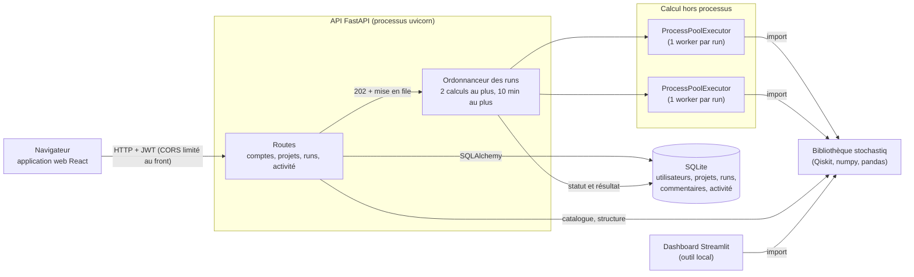

# Architecture du prototype StochastiQ

StochastiQ est un prototype universitaire, pas une application de production. Il comporte quatre parties, chacune dans son dossier :

| Partie | Dossier | Rôle |
|---|---|---|
| Bibliothèque | `src/stochastiq/` | calculs (ansatz, métriques, coût matériel, scaling) ; **aucune dépendance web** |
| API | `api/` | FastAPI, SQLAlchemy, SQLite, Alembic : comptes, projets, rôles, runs, activité |
| Application web | `web/` | React (Vite, TypeScript), Recharts : écrans d'équipe et écrans scientifiques |
| Dashboard Streamlit | `dashboard/` | outil local d'exploration, hors application web |

## Sens des dépendances

L'API importe la bibliothèque, jamais l'inverse. La bibliothèque s'installe et se teste seule (`pip install -e ".[dev]"`, puis `pytest`), y compris dans l'intégration continue. Le front ne parle qu'à l'API.

## Cycle de vie d'un run

1. `POST /projects/{id}/runs` valide les paramètres (bornes de calcul), enregistre le run en `pending`, ajoute l'événement `run_launched` et répond 202.
2. L'ordonnanceur (deux fils au plus) passe le run en `running`, puis lance le calcul dans un `ProcessPoolExecutor` dédié, à un seul worker.
3. À la fin, le résultat (JSON standard, `NaN` remplacés par `null`) et le statut `done` ou `failed` sont écrits en base, avec l'événement `run_done` ou `run_failed`.
4. Au-delà de 10 minutes, le processus du run est tué et le run passe en `failed`. Les autres calculs ne sont pas touchés.
5. Au démarrage de l'API, les runs restés `pending` ou `running` passent en `failed` avec un message explicite. Il n'y a pas de file de jobs externe.

Le front suit un run en interrogeant `GET /projects/{id}/runs/{run_id}` toutes les 2 secondes. Le sondage s'arrête quand le composant est démonté.

## Données

SQLite, avec un fichier configurable par `DATABASE_URL` et un schéma géré par Alembic (`api/stochastiq_api/migrations`). L'API applique les migrations au démarrage. Tables :
- `users`, `projects`, `memberships`, `invitations` ;
- `runs`, `comments`, `activity_events`, `pinned_circuits`, `machines`.

Aucune clé de machine réelle n'est stockée.

## Déploiement

`docker-compose.yml` lance deux services :
- `api` : image Python, base SQLite dans le volume `api-data`, healthcheck sur `/health` ;
- `web` : build Vite servi par nginx, sur le port 5173 de l'hôte, comme en développement.

Les variables sont lues dans `.env` (voir `.env.example`).
