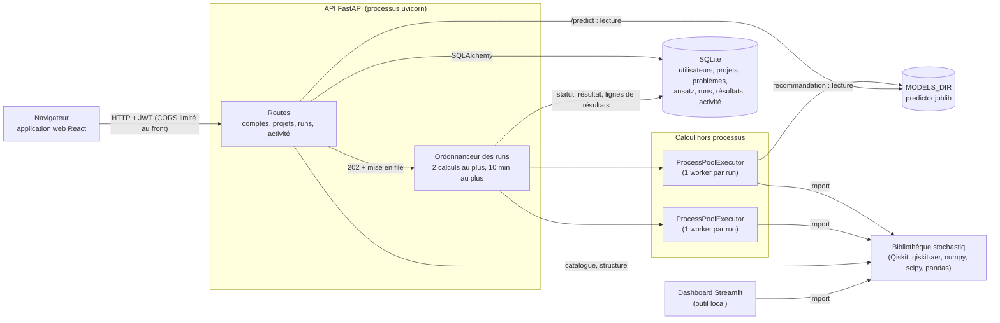

# Architecture du prototype StochastiQ

StochastiQ est un prototype universitaire, pas une application de production. Il comporte quatre parties, chacune dans son dossier :

| Partie | Dossier | Rôle |
|---|---|---|
| Bibliothèque | `src/stochastiq/` | calculs génériques : ansatz (catalogue et personnalisés), métriques, coût matériel, scaling, distributions, entraînement QCBM, références classiques, bruit simulé ; **aucune dépendance web** |
| API | `api/` | FastAPI, SQLAlchemy, SQLite, Alembic : comptes, projets, rôles, problèmes, ansatz personnalisés, runs, activité ; base de résultats et IA de prédiction (`api/stochastiq_api/ml/`) |
| Application web | `web/` | React (Vite, TypeScript), Recharts : écrans d'équipe et écrans scientifiques |
| Dashboard Streamlit | `dashboard/` | outil local d'exploration, hors application web |

## Sens des dépendances

L'API importe la bibliothèque, jamais l'inverse. La bibliothèque s'installe et se teste seule (`pip install -e ".[dev,noise,qasm3]"`, puis `pytest`), y compris dans l'intégration continue. Les options `noise` (qiskit-aer) et `qasm3` (qiskit_qasm3_import) ajoutent le bruit simulé et l'import OpenQASM 3. Le front ne parle qu'à l'API.

Tout ce qui accumule ou exploite des données vit dans `api/stochastiq_api/ml/`, qui seul dépend de scikit-learn et de joblib :
- `results.py` : lignes de la base de résultats, lignes éligibles à l'IA, export CSV ou Parquet ;
- `predictor.py` : modèles, validations, calibrage conforme, prédiction ;
- `service.py` : caractéristiques d'un cas et prédiction (route `/predict`, recommandation) ;
- `recommendation.py` : entraînements existants, calcul de la recommandation, règles de décision ;
- `bootstrap.py` : entraînement du modèle au démarrage s'il est absent.

Le client ne fournit jamais de code exécutable : un ansatz personnalisé est une spec JSON ou un texte OpenQASM, validés (portes autorisées, tailles bornées) ; toutes les entrées passent par des schémas pydantic aux tailles bornées.

## Cycle de vie d'un run

1. `POST /projects/{id}/runs` valide les paramètres (bornes de calcul), enregistre le run en `pending`, ajoute l'événement `run_launched` et répond 202.
2. L'ordonnanceur (deux fils au plus) passe le run en `running`, puis lance le calcul dans un `ProcessPoolExecutor` dédié, à un seul worker.
3. À la fin, le résultat (JSON standard, `NaN` remplacés par `null`) et le statut `done` ou `failed` sont écrits en base, avec l'événement `run_done` ou `run_failed`. Pour un run réussi de diagnostic, de bruit ou d'entraînement, les lignes de la base de résultats sont ensuite ajoutées ; un échec à cette étape ne change pas l'état du run.
4. Au-delà de 10 minutes, le processus du run est tué et le run passe en `failed`. Les autres calculs ne sont pas touchés.
5. Au démarrage de l'API, les runs restés `pending` ou `running` passent en `failed` avec un message explicite. Il n'y a pas de file de jobs externe.

Avant l'enregistrement, l'API remplace un ansatz personnalisé (`{"custom_id": n}`) par son contenu complet et recopie la distribution cible d'un problème ; une recommandation recopie aussi les entraînements existants. Le run reste reproductible même si ces objets changent ensuite. Le processus de calcul n'accède jamais à la base.

Le front suit un run en interrogeant `GET /projects/{id}/runs/{run_id}` toutes les 2 secondes. Le sondage s'arrête quand le composant est démonté.

## Données

SQLite, avec un fichier configurable par `DATABASE_URL` et un schéma géré par Alembic (`api/stochastiq_api/migrations`). L'API applique les migrations au démarrage. Tables :
- `users`, `projects`, `memberships`, `invitations` ;
- `runs`, `comments`, `activity_events`, `pinned_circuits`, `machines` ;
- `problems` (vecteur de probabilités et caractéristiques ; le texte d'un CSV importé n'est pas conservé), `custom_ansatz` ;
- `results` : base de résultats (caractéristiques, profil de bruit, grandeurs mesurées ; jamais de probabilités brutes), alimentée par les runs et par la grille de référence (`scripts/build_results.py`).

La colonne `projects.share_results` (faux par défaut) décide si les lignes d'un projet servent à entraîner l'IA. Le modèle de prédiction est un fichier (`predictor.joblib`) dans `MODELS_DIR`, hors base.

Aucune clé de machine réelle n'est stockée.

## Déploiement

`docker-compose.yml` lance deux services :
- `api` : image Python, base SQLite et modèle de prédiction (`/data/models`) dans le volume `api-data`, healthcheck sur `/health`. Au premier démarrage, l'entrée du conteneur entraîne le modèle à partir de `data/results_grid.csv` (copié dans l'image) avant de lancer uvicorn ; le healthcheck laisse 10 minutes pour cela ;
- `web` : build Vite servi par nginx, sur le port 5173 de l'hôte, comme en développement.

Les variables sont lues dans `.env` (voir `.env.example`).
